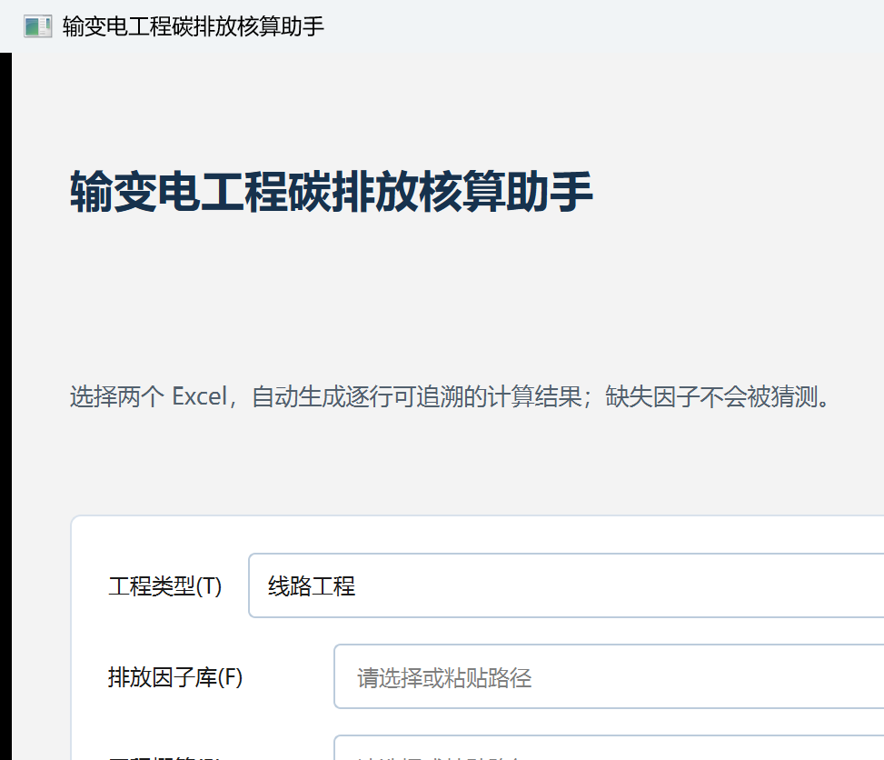

# 输变电工程碳排放概算助手

面向输电线路、换流站及其他电网建设项目的 Windows 离线碳排放技术试算工具。程序读取排放因子库与工程概算 Excel，自动识别可核算数据，执行可靠因子匹配、单位换算和排放计算，并生成可追溯的结果工作簿。

## 主要功能

- 支持线路工程、换流站工程、其他项目和跨项目汇总四种模式。
- 按表头与数据结构识别材料、设备、施工机械及活动量字段。
- 采用保守匹配策略；缺失因子、单位冲突和不确定候选保持“未计算”。
- 支持线路线损和换流站 SF6 逸散等可选补充参数。
- 输出项目总览、分类汇总、逐行明细、匹配审核、未计算说明和结果图表。
- 不覆盖输入的因子库和工程概算文件。

## 下载与运行

请在仓库的 **Releases** 页面下载 `v0.1.0-demo` Windows x64 压缩包：

1. 将 ZIP 完整解压到普通可写目录。
2. 保留程序目录和 `_internal` 目录的相对位置，不能只移动 EXE。
3. 双击 `输变电工程碳排放概算助手.exe`。
4. 选择工程类型、排放因子库、项目概算和输出目录后开始计算。

该程序尚未进行代码签名，Windows 可能显示安全提示。请仅从本仓库 Release 下载，并核对 Release 中公布的 SHA-256。

## 技术实现

历史构建采用：

- Python 3.12
- PySide6
- openpyxl
- Decimal 精确数值计算
- PyInstaller one-folder 打包

## 公开版本说明

本仓库为个人求职作品集展示版本。公开压缩包已移除真实工程概算、真实计算结果、甲方文档、内部路径和聊天记录，不包含排放因子库或客户数据。

原项目目录已丢失，目前找回的是可运行发布包，因此本仓库暂不包含可维护的 Python 源码。Release 可以用于体验软件界面和已实现的工作流程，但不能替代源码审查。

本工具输出属于技术试算结果，不构成第三方核证、正式认证或投资决策依据。

## 权利与使用

本仓库仅用于个人作品集展示。未附开源许可证，不表示授予复制、修改、再发布或商业使用许可。项目涉及的原始业务资料、排放因子和客户数据均不在本仓库中。
